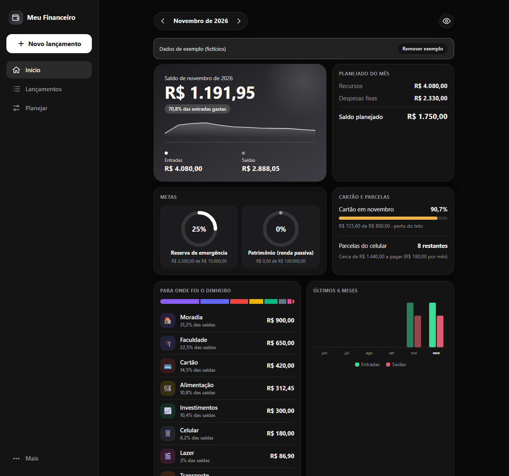
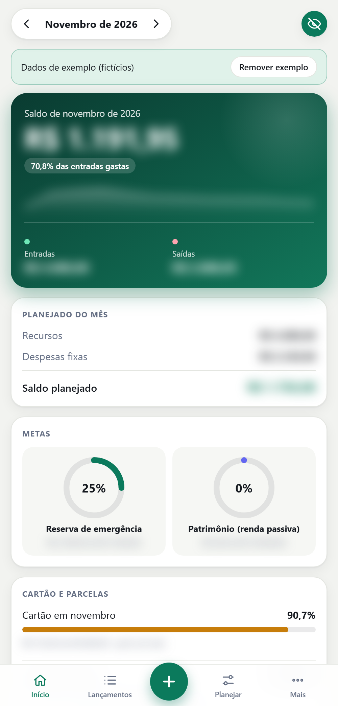

# Meu Financeiro

Aplicativo web de **controle financeiro pessoal**: visão geral do mês, lançamentos de entradas e saídas, metas (reserva e patrimônio), planejamento por categoria e evolução dos últimos 6 meses. Funciona direto no navegador, sem conta e sem servidor: os dados ficam só no seu aparelho.

**Experimente:** <https://nevessdhiego-design.github.io/meu-financeiro/?demo> (o `?demo` carrega dados de exemplo, todos fictícios).

<p align="center">
  
</p>

<p align="center">
  
  
  
  
</p>

## O que ele faz

- **Início:** saldo do mês com a evolução do dia a dia, planejado x realizado, metas em anéis (reserva e patrimônio), uso do teto do cartão, parcelas restantes, para onde foi o dinheiro (por categoria) e entradas x saídas dos últimos 6 meses.
- **Navegação por mês:** setas ou seletor no topo mudam o mês de todas as telas.
- **Lançamentos:** lista agrupada por dia, com **busca por texto** (sem diferenciar acento ou maiúsculas) e filtros por mês, categoria e tipo; toque num item para editar ou excluir; indicação de lançamentos não pagos. Tocar numa categoria do Início já abre a lista filtrada.
- **Planejar:** orçamento restante por categoria e configuração de salário, benefícios, metas e dias úteis, em grupos de campos no estilo das configurações do iPhone.
- **Modo privacidade:** um toque borra todos os valores na tela (útil em lugares públicos); a escolha fica salva.
- **Backup:** exporta um JSON pela **folha de compartilhar** do celular (Arquivos, iCloud Drive etc.) ou por download no computador, avisa quando o último backup está velho e restaura com prévia antes de gravar.
- **Tema claro e escuro:** segue o aparelho e pode ser fixado em **Mais → Tema**.
- **Importar extrato do banco:** lê arquivos **OFX**, **CSV** e **PDF** com texto exportados pelo banco ou pelo cartão (conta corrente e fatura), tudo no próprio aparelho (o leitor de PDF, pdf.js, é baixado com verificação de integridade só quando se importa um PDF). Reconhece as colunas sozinho, sugere a categoria pela descrição, ignora o que já foi importado (não duplica ao reimportar) e mostra uma prévia com as opções "fatura de cartão" e "inverter entradas e saídas" antes de gravar. Pagamento de fatura, transferência entre contas próprias e resgate são tratados como movimentação neutra (não contam como gasto nem ganho), parcelas (`3/10`) são reconhecidas e projetadas nos meses seguintes, e o app avisa quando os números não fazem sentido (por exemplo, mês só com compras no cartão). A categoria é sugerida por palavras e passa a aprender: ao corrigir um lançamento, o app aplica a mesma categoria aos parecidos e às próximas importações. Há exemplos fictícios em [`docs/exemplos/`](docs/exemplos).
- **Sincronização entre aparelhos (opcional):** notebook e celular iguais, com os dados criptografados no próprio aparelho (AES-GCM, chave derivada de uma senha que nunca sai dele) e guardados em um projeto Supabase próprio. A mesclagem usa o lançamento mais recente e registra os apagados. Passo a passo em [`docs/sincronizacao.md`](docs/sincronizacao.md).
- **Planilhas:** importação e exportação de `.xlsx`.
- **PWA:** `manifest` e *service worker* para instalar na tela inicial e abrir sem internet.

## Instalar no iPhone

1. Abra <https://nevessdhiego-design.github.io/meu-financeiro/> no **Safari** (precisa ser o Safari).
2. Toque em **Compartilhar** (o quadrado com a seta para cima) e em **Adicionar à Tela de Início**.
3. Abra pelo novo ícone: o app roda em tela cheia e guarda os dados no próprio aparelho.

Os dados do app instalado ficam separados dos do Safari, então **faça o backup antes de instalar** se você já usava o site no navegador e restaure depois pelo menu ☰. No Android, use o Chrome (menu ⋮, **Instalar app**).

## Como foi feito

| Parte | Tecnologia |
|---|---|
| Interface | HTML, CSS e JavaScript puros (sem framework e sem *build*): `index.html`, `css/styles.css`, `js/app.js`; layout mobile primeiro (barra de abas no celular, menu lateral no computador), ícones em SVG embutido e tema por variáveis CSS |
| Lógica pura | `js/lib.js` (formatação, leitura de OFX, CSV e do texto de PDF, categorias sugeridas, duplicados, totais por mês e por categoria, agrupamento por dia, busca, status do backup), sem DOM e testável no Node |
| Armazenamento | `localStorage` do navegador |
| Planilhas | [SheetJS](https://sheetjs.com/) por CDN, com verificação de integridade (SRI) |
| API opcional | Python, FastAPI e SQLite, em `backend/` (veja o [README do backend](backend/README.md)) |
| Testes | `node --test` na lógica (52 testes) e `pytest` na API (13 testes), ambos na CI do GitHub |

Decisões que valem destacar:

- **Privacidade por padrão:** nada sai do navegador. O repositório não contém dados reais; os valores iniciais e o conteúdo de `?demo` são fictícios.
- **Sem dependência de servidor:** o app funciona sozinho; a sincronização entre aparelhos é opcional e usa um projeto Supabase do próprio usuário, com tudo criptografado antes de sair.
- **Segurança na interface:** tudo o que vem de planilha ou de backup é escapado antes de ir para o HTML.
- **Fuso horário correto:** datas e meses usam o horário local, não UTC.
- **Pensado para o celular:** barra de abas ao alcance do polegar, folhas que sobem de baixo para lançar e editar, campos de 16 px (o Safari não dá zoom ao digitar), teclado decimal no valor e pedido de armazenamento persistente.

## Como rodar

O app é estático. Na pasta do projeto:

```powershell
python -m http.server 8000
```

Abra `http://localhost:8000/?demo` no navegador. Atalhos úteis na URL: `?demo` (dados de exemplo), `&tab=lanc` ou `&tab=plan` (abre a aba), `&privacidade` (valores ocultos) e `&tema=claro` ou `&tema=escuro`.

Testes da lógica (precisa do Node 20 ou superior):

```powershell
node --test "tests/*.test.js"
```

API e testes da API:

```powershell
cd backend
python -m venv .venv
.\.venv\Scripts\Activate.ps1
pip install -r requirements-dev.txt
pytest
uvicorn main:app --reload --port 8000
```

A documentação interativa da API fica em `http://127.0.0.1:8000/docs`.

## Limitações conhecidas

- Os dados ficam só no navegador: trocar de aparelho, limpar os dados do site ou desinstalar o app apaga tudo. Use o **Backup** com regularidade.
- A API ainda **não tem autenticação**; por isso não está conectada ao app nem publicada (detalhes no README do backend).
- A importação de planilha `.xlsx` espera colunas de data, descrição, valor, tipo, categoria e forma de pagamento; o app mostra uma prévia e só grava depois de você confirmar.
- Cada banco exporta de um jeito. O leitor de CSV cobre os formatos mais comuns (separador `;` ou `,`, valores com vírgula ou ponto, colunas de crédito e débito, fatura de cartão), mas um layout fora do padrão pode não ser reconhecido; a prévia mostra isso antes de gravar. A categoria é só uma sugestão por palavras-chave e pode ser corrigida em cada lançamento. O PDF é lido pelo texto, sem OCR (não funciona com foto ou PDF escaneado), e como cada banco diagrama o PDF de um jeito, a leitura é por heurística: a prévia pede conferência e, quando o PDF não indica entrada ou saída, o app avisa quantos itens foram deduzidos pelas palavras. Não há conexão automática com bancos (Open Finance).
- Não há testes automatizados da interface (só da lógica em `js/lib.js` e da API); a conferência da tela é manual.

## Próximos passos

- Autenticação na API própria (a sincronização atual usa o Supabase com dados criptografados no aparelho).
- Orçamento por categoria editável, lançamentos recorrentes e regras de categoria personalizadas para a importação.
- Testes automatizados da interface.

## Licença

[MIT](LICENSE).
