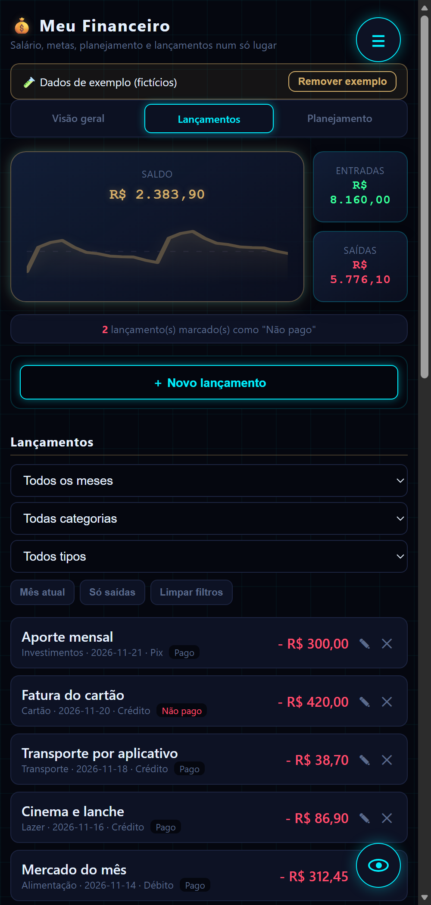
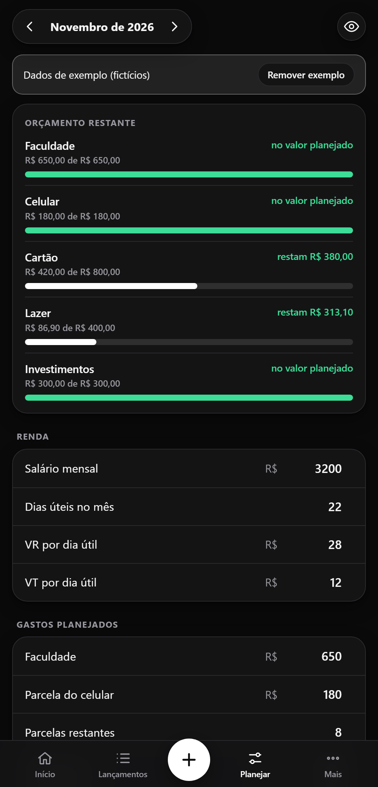

# Meu Financeiro

Aplicativo web de **controle financeiro pessoal**: visão geral do mês, lançamentos de entradas e saídas, metas (reserva e patrimônio) e planejamento por categoria. Funciona direto no navegador, sem conta e sem servidor: os dados ficam só no seu aparelho.

**Experimente:** <https://nevessdhiego-design.github.io/meu-financeiro/?demo> (o `?demo` carrega dados de exemplo, todos fictícios).

<p align="center">
  
  
  
</p>

## O que ele faz

- **Visão geral:** recursos e despesas fixas do mês, saldo planejado, progresso da reserva de emergência e da meta de patrimônio, uso do teto do cartão e parcelas restantes do celular.
- **Lançamentos:** cadastro, edição e exclusão; filtros por mês, categoria e tipo; indicação de lançamentos não pagos; gráfico de saldo e gastos por categoria.
- **Planejamento:** orçamento restante por categoria e configuração de salário, benefícios, metas e dias úteis.
- **Dados:** importação e exportação de planilha (`.xlsx`), backup e restauração em JSON (com prévia antes de gravar) e botão para limpar os lançamentos.
- **PWA:** `manifest` e *service worker* para instalar na tela inicial e abrir sem internet.

## Como foi feito

| Parte | Tecnologia |
|---|---|
| Interface | HTML, CSS e JavaScript puros (sem framework e sem *build*), em `index.html`, `css/styles.css` e `js/app.js` |
| Armazenamento | `localStorage` do navegador |
| Planilhas | [SheetJS](https://sheetjs.com/) por CDN, com verificação de integridade (SRI) |
| API opcional | Python, FastAPI e SQLite, em `backend/` (veja o [README do backend](backend/README.md)) |
| Testes | `pytest` na API (13 testes), executados na CI do GitHub |

Decisões que valem destacar:

- **Privacidade por padrão:** nada sai do navegador. O repositório não contém dados reais; os valores iniciais e o conteúdo de `?demo` são fictícios.
- **Sem dependência de servidor:** a API existe para a próxima etapa (sincronização entre aparelhos), mas o app não precisa dela.
- **Segurança na interface:** tudo o que vem de planilha ou de backup é escapado antes de ir para o HTML.
- **Fuso horário correto:** datas e meses usam o horário local, não UTC.

## Como rodar

O app é estático. Na pasta do projeto:

```powershell
python -m http.server 8000
```

Abra `http://localhost:8000/?demo` no navegador.

Para a API e os testes:

```powershell
cd backend
python -m venv .venv
.\.venv\Scripts\Activate.ps1
pip install -r requirements-dev.txt
pytest
uvicorn main:app --reload --port 8000
```

A documentação interativa da API fica em `http://127.0.0.1:8000/docs`.

## Limitações conhecidas

- Os dados ficam só no navegador: trocar de aparelho ou limpar os dados do site apaga tudo. Use o **Backup JSON** com regularidade.
- A API ainda **não tem autenticação**; por isso não está conectada ao app nem publicada (detalhes no README do backend).
- A importação de planilha espera colunas de data, descrição, valor, tipo, categoria e forma de pagamento; o app mostra uma prévia e só grava depois de você confirmar.
- Não há testes automatizados da interface; a conferência é manual.

## Próximos passos

- Autenticação e sincronização (por exemplo, Supabase com Auth e RLS, ou a API própria com login).
- Testes automatizados da interface.
- Gráficos de evolução mensal e metas por categoria.

## Licença

[MIT](LICENSE).
